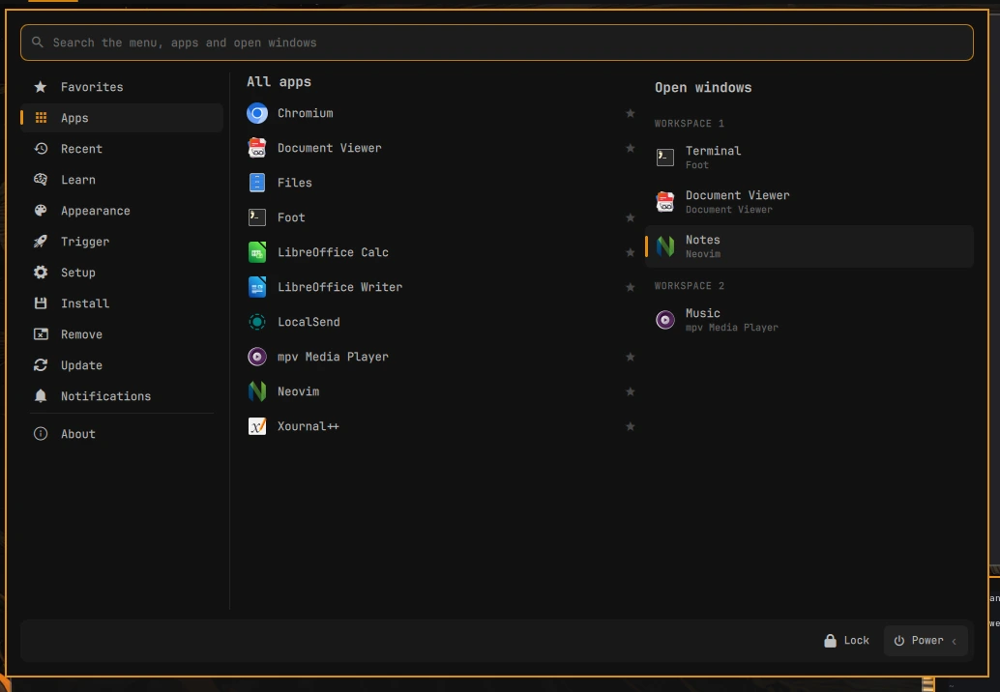
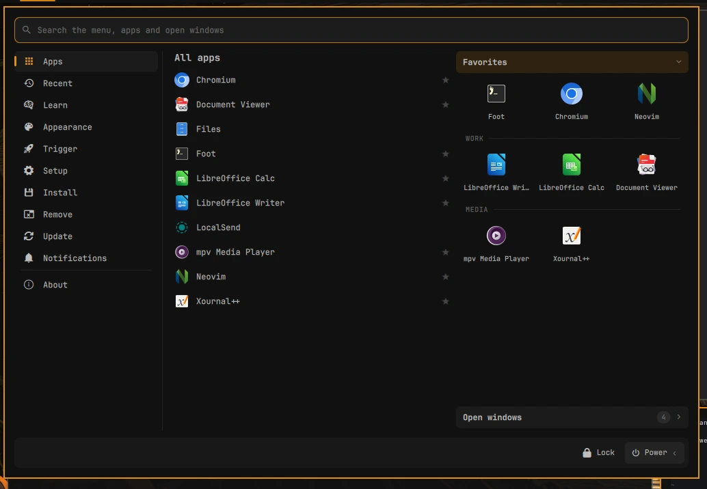
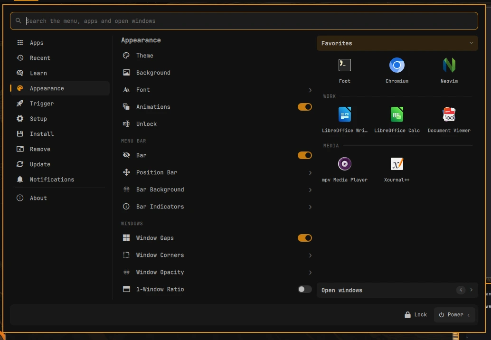
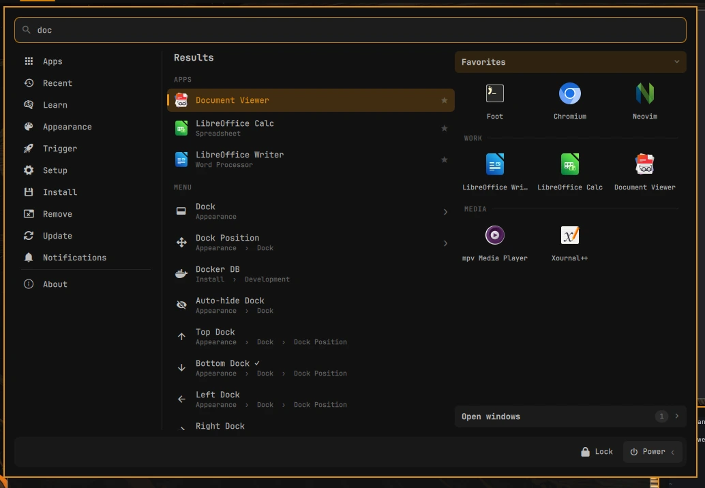
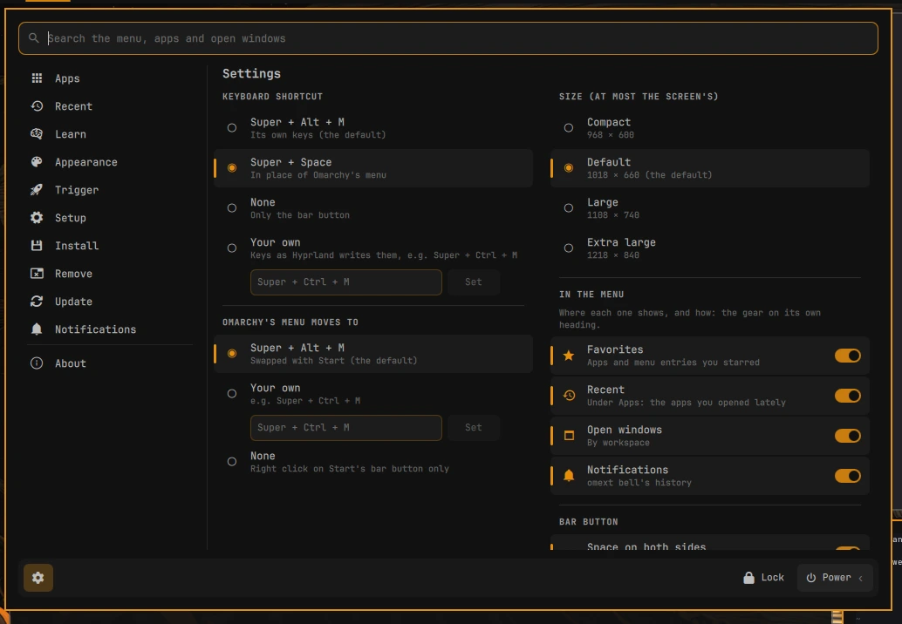

# omext start

Part of [**omarchy-extended**](https://github.com/omarchy-extended): addons for [Omarchy](https://omarchy.org).

A start menu for Omarchy, on the bar next to the world clock. The whole Omarchy menu
on one page, your apps, and every open window by workspace, with one search
for all of it.



## What's in it

- **The Omarchy menu, laid out flat.** Its sections down the left (Apps, Learn,
  Appearance, Trigger, Setup, Install, Remove, Update, About). The chosen one
  fills the middle, each submenu as a heading with its entries under it. A
  submenu deeper than that opens in place, with a way back.
- **The same menu as Omarchy's.** It reads Omarchy's menu files with Omarchy's
  own code, so new entries from an update, your own entries in
  `~/.config/omarchy/extensions/omarchy-menu.jsonc`, translations, and the ✓ on
  the current choice all show up. Settings Omarchy lists as an on/off pair
  ("Hide Bar" / "Show Bar", "Window Gaps Off" / "On") are one row with a switch,
  flipped in place. The lists Omarchy fills in itself (fonts,
  kernels, languages, power profiles) are filled in here too, with a ✓ on the
  one in use.
- **All apps**, A to Z, leaving out the same ones Omarchy's launcher does.
- **Recent**, under Apps: the apps you used lately and have closed since,
  started from this menu or any other way, the latest first (Settings turns
  it off).
- **Open windows**, grouped by workspace (with the monitor, on more than one), then
  the windows in [omext docks](https://github.com/omarchy-extended/docks) and on
  the scratchpad. Click one to go to it (one in a dock: the dock opens on it,
  with the pointer on it). The ✕ that shows on hover closes it.
  With [omext taskbar](https://github.com/omarchy-extended/taskbar) showing them,
  you may not want them here too: Settings turns them off.
- **Favorites.** Point at an app or a menu entry and click its star (or right
  click it) to keep it in Favorites, and again to take it out. Drag one to where you want it, or have them A to Z (their settings › Order).
  Their settings also add groups (a heading among them: drag it and the group
  moves with it; a double click renames it) and, at the menu's right, show them as
  icons or as a list.
- **Notifications**, with [omext bell](https://github.com/omarchy-extended/bell)
  installed: its notification history as a section, with how many are new.
  Point at their heading for Do Not Disturb and Clear all.
- **Each where you want it.** Start's Settings turn the favorites, the open
  windows and the notifications on or off in the menu. Point at one's heading
  for a gear: its own settings, which say where it is (a page from the left
  menu, or at the menu's right) and, for the notifications, whether the bell
  leaves the bar while they're here.
- **At the right**, each one has a column of its own or shares one with the
  one you pick (its settings › Column), in any mix: the favorites and the open
  windows sharing a column beside the notifications' own, say. A shared column
  has a heading each and one open at a time: a click on a heading opens it.
  Where the screen has no room for the columns, they all share one.
  Drag a heading onto another's place to reorder them.
- **Lock and Power** at the bottom right. Power opens the rest of the System
  entries between them (Screensaver, Suspend, Logout, Reboot, Shutdown, ...).
  With no column at the right the menu is narrower, and they're icons: the one
  you point at is named at the row's left.
- **Search** covers the menu, the apps and the open windows, with each entry's
  description and where it is in the menu.
- **On or off.** Omarchy menu › Setup › Omarchy Extended › Start, or Turn off this menu at the bottom of Settings. Off,
  there's no bar button and no shortcut (Super + Space is Omarchy's menu's
  again); on, it's all back as it was.
- **Omarchy's dock off**, if Start covers what you used it for: Omarchy menu ›
  Setup › Omarchy Extended › Omarchy Dock, or in Start's Settings. Super + Alt + Space then opens
  Start's apps, and minimized windows come back from Start's Open windows.
  Turning Start off (or uninstalling it) brings Omarchy's dock back, except
  while [omext taskbar](https://github.com/omarchy-extended/taskbar) is on: it
  keeps the dock off, in its place.
- **Settings** (the gear, bottom left): the keyboard shortcut, room on both
  sides of the bar button, and a label after its icon (part of the button).







## Keys

| Key | Does |
| --- | --- |
| Super + Alt + M | Open or close Start (change it in Settings) |
| Type | Search |
| Up / Down, Page Up / Page Down | Move through the middle's entries (Page: six at a time) |
| Enter / Right | Run an entry, or open it |
| Left / Backspace | Back from a submenu (with an empty search) |
| Delete | On an app: uninstall it (asks first) |
| Tab / Shift + Tab | Next or previous area: the list, the favorites and open windows at the right, the row at the foot (the gear, Lock, Power). A frame shows where the keyboard is; the arrows move there and Enter runs what's chosen |
| Ctrl + Tab / Ctrl + Shift + Tab | Next or previous section |
| Ctrl + D | The chosen app's star, on or off |
| Esc | Clear the search, go back from a submenu, then close |

## Settings

The gear at the bottom left (it scrolls on a small screen). They're kept in `~/.config/omext/start.json`, the
same for Start on every screen.

- **Keyboard shortcut.** Super + Alt + M by default, which Omarchy leaves free.
  Super + Space puts Start in place of Omarchy's menu (a right click on the bar
  button still opens that). Or keys of your own, written as Hyprland writes them
  (`Super + Ctrl + M`); Start tells you if they do something else now. Or none.
  With Start on Super + Space, Omarchy's menu moves: to Super + Alt + M (a
  swap, the default), to keys of your own, or to none (then it's on the bar
  button's right click).
- **Size**: Compact, Default, Large or Extra large; never more than the
  screen has room for.
- **In place of Omarchy's menu button**: Start's button goes where Omarchy's
  own is on the bar, and that one leaves it (its menu is still on its keys, and
  on a right click on Start's button). Back when Start is turned off or removed.
  With Start on the taskbar as well, it has a button in both places: the bar's
  opens the menu under it, the taskbar's above the taskbar.
- **Space on both sides** of the bar button.
- **Label**: text after the icon, for example "Start". It's part of the button,
  so a wider place to click.
- **On the taskbar**, with [omext taskbar](https://github.com/omarchy-extended/taskbar)
  installed: the button moves from the top bar to the taskbar's left end, and
  the menu opens above it, centred on the screen.

A right click on the bar button opens Omarchy's own menu. From a script:

```bash
omarchy-shell omext.start toggle
omarchy-shell omext.start page appearance      # a section, or a submenu: setup.power, ...
omarchy-shell omext.start page wallpaper       # or an alias of Omarchy's menu: the page it's on
omarchy-shell omext.start page notifications   # with omext bell
omarchy-shell omext.start page favorites       # or windows, recent: Start's own pages, when they're in the left menu
omarchy-shell omext.start find "theme"         # open with a search
omarchy-shell omext.start settings
omarchy-shell omext.start off                  # or on
```

It opens on the screen that has the focus.



## Compatibility

Needs **Omarchy 4.5** or later (tested on 4.5.0): it uses the menu code of
Omarchy's shell, from `/usr/share/omarchy/shell/plugins/menu/`. If a future
Omarchy changes that code, this menu may need an update too.

It uses [omext core](https://github.com/omarchy-extended/core) (what the omext
addons share): `install.sh` installs that too, when it's missing.

## Install

You need Omarchy 4.5 or later.

```bash
git clone https://github.com/omarchy-extended/start.git ~/.local/share/omext-start
~/.local/share/omext-start/install.sh
```

Start goes on the bar right after the world clock (or the clock, without one),
and Super + Alt + M opens it. Move it like any other bar widget,
for example with `omarchy bar move omext.start --section right`. A `git pull` in
that folder updates it. `./uninstall.sh` removes it.

## Files

| Path | What |
| --- | --- |
| `plugins/omext.start/` | The Omarchy shell plugin: the bar button and the menu. |
| `menu.jsonc` | The Start entry (on or off) for the Omarchy menu. |
| `hypr/start.lua` | The keyboard shortcut, read from `~/.config/omext/start.json`. |
| `install.sh`, `uninstall.sh` | Link the plugin into `~/.config/omarchy/plugins/`, load `hypr/start.lua` from `~/.config/hypr/hyprland.lua`, add the Omarchy menu entry and put Start on the bar, or take it all off again. |

## License

MIT. See [LICENSE](LICENSE).
